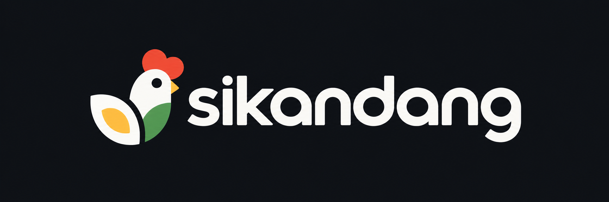

# SiKandang

  

  Aplikasi pencatatan pakan dan panen telur untuk peternakan ayam skala kecil.

## Features

- Pencatatan stok dan pemberian pakan.
- Pencatatan hasil panen telur.
- Validasi stok otomatis menggunakan database trigger.
- Pencatatan mutasi stok.
- Transaksi atomik menggunakan stored procedure.

## Tech Stack

- **Frontend:** HTML, Tailwind CSS
- **Backend:** PHP
- **Database:** MariaDB

## Database Logic

| Component | Responsibility |
|---|---|
| `trg_cek_pakan` | Memvalidasi kecukupan stok |
| `trg_mutasi_pakan` | Memperbarui stok dan mencatat mutasi |
| `sp_catatan_harian` | Memproses pemberian pakan dan panen secara atomik |

## Database Tables

`pakan` · `pemberian_pakan` · `panen_telur` · `log_stok_pakan`

## Getting Started

1. `git clone git@github.com:jaweed3/uts-web-dasar`.
2. `cat backend/db/*.sql | mariadb -u username -p database_name`
3. `run the php (/opt/lampp/bin/php -S 0.0.0.0:8000 -t backend/public backend/public/router.ph) ini buat router ya!!!!`
4. `dan kalo mau cek servernya (curl -s http://localhost:8000/sikandang/api/v1/pakan)`

## Project

Developed for the Database Systems II and Web Programming Basic midterm project at Universitas Darussalam Gontor.
