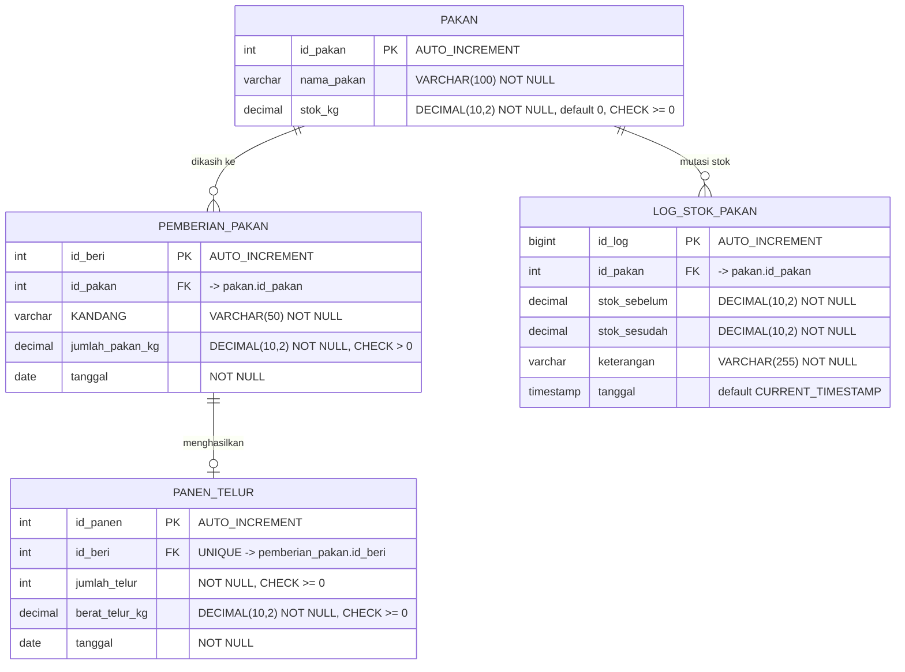

# SiKandang — Database

Skema basis data untuk aplikasi pencatatan pakan dan panen telur.
Engine: **MariaDB** (MySQL-compatible). Semua tabel memakai InnoDB.

---

## ER Diagram



### Relasi singkat

| Dari                       | Ke                        | Jenis       | Arti                                         |
| -------------------------- | ------------------------- | ----------- | -------------------------------------------- |
| `pemberian_pakan.id_pakan` | `pakan.id_pakan`          | many-to-one | Satu jenis pakan diberikan ke banyak kandang |
| `panen_telur.id_beri`      | `pemberian_pakan.id_beri` | one-to-one  | 1 pemberian = maks 1 panen telur             |
| `log_stok_pakan.id_pakan`  | `pakan.id_pakan`          | many-to-one | 1 pakan bisa punya banyak riwayat mutasi     |

---

## Tabel

| Tabel             | Isi                                 | Peran                          |
| ----------------- | ----------------------------------- | ------------------------------ |
| `pakan`           | Master pakan + stok saat ini        | Sumber kebenaran stok          |
| `pemberian_pakan` | Riwayat pemberian pakan per kandang | Diisi user, divalidasi trigger |
| `panen_telur`     | Hasil panen telur                   | Terikat 1:1 ke pemberian       |
| `log_stok_pakan`  | Audit trail perubahan stok          | Otomatis oleh trigger          |

---

## Trigger & Stored Procedure

Stok **tidak pernah** diubah langsung oleh aplikasi. Semua pengurangan stok terjadi
lewat trigger, jadi validasi tidak bisa di-bypass (walau insert via CLI/Postman).

```mermaid
flowchart TD
    A["PHP: POST /catatan-harian"] --> B["CALL sp_catatan_harian"]
    B --> C["START TRANSACTION"]
    C --> D["INSERT pemberian_pakan"]
    D --> E["trg_cek_pakan (BEFORE INSERT)"]
    E --> F{"stok cukup?"}
    F -->|tidak --> G["SIGNAL 45000"]
    G --> H["ROLLBACK + RESIGNAL ke PHP"]
    F -->|ya --> I["trg_mutasi_pakan (AFTER INSERT)"]
    I --> J["UPDATE pakan.stok_kg"]
    I --> K["INSERT log_stok_pakan"]
    J --> L["INSERT panen_telur"]
    K --> L
    L --> M["COMMIT"]
```

| Objek               | File              | Timing                          | Fungsi                                            |
| ------------------- | ----------------- | ------------------------------- | ------------------------------------------------- |
| `trg_cek_pakan`     | `03_triggers.sql` | BEFORE INSERT `pemberian_pakan` | Tolak INSERT kalau stok kurang / pakan tidak ada  |
| `trg_mutasi_pakan`  | `03_triggers.sql` | AFTER INSERT `pemberian_pakan`  | Potong stok + catat ke `log_stok_pakan`           |
| `sp_catatan_harian` | `04_sp.sql`       | Stored Procedure                | Simpan pemberian + panen dalam 1 transaksi atomik |

---

## File & Urutan Import

```
01_schema.sql      CREATE DATABASE + CREATE TABLE
02_seed.sql        Data dummy (3 jenis pakan)
03_triggers.sql    2 trigger
04_sp.sql          1 stored procedure
05_test.sql        Script test manual
```

```bash
mysql -u root -p < 01_schema.sql
mysql -u root -p < 02_seed.sql
mysql -u root -p < 03_triggers.sql
mysql -u root -p < 04_sp.sql
mysql -u root -p < 05_test.sql
```

> File trigger/procedure pakai `DELIMITER //` di dalam. Jangan diedit tanpa
> paham delimiter-nya, dan pastikan ada `DELIMITER ;` di akhir file.

---

## Test

`05_test.sql` berisi skenario:

1. Stok cukup → stok berkurang, `log_stok_pakan` terisi.
2. Stok kurang → error `Stok pakan tidak mencukupi`, stok & tabel tidak berubah.
3. `CALL sp_catatan_harian(...)` → pemberian + panen + log semua masuk.
4. Procedure gagal → rollback, `panen_telur` tidak nambah.
5. Query gabungan (dipakai endpoint `GET /catatan-harian`).
